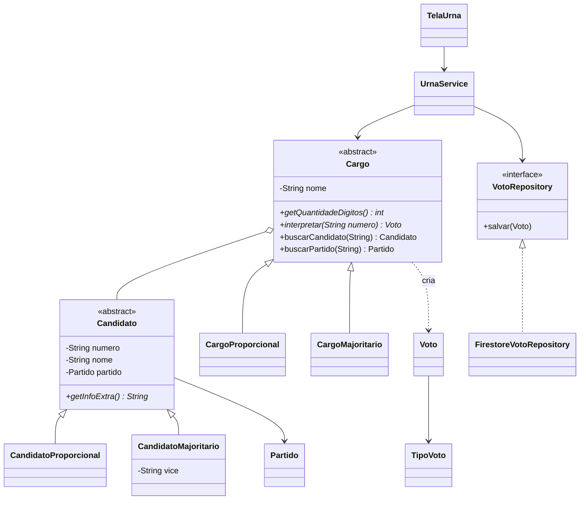

# Urna Cidadã 🗳️

Simulador de urna eletrônica em **Java**, com interface em **Java Swing** e votos gravados no **Firebase (Cloud Firestore)**.
AV3 – Programação Orientada a Objetos – Ciência da Computação – UNIJORGE – 2026.2

A votação segue a ordem da urna real:

| Ordem | Cargo    | Tipo         | Dígitos | Regra |
|-------|----------|--------------|---------|-------|
| 1º    | Vereador | Proporcional | 5       | Se o partido existe mas o candidato não, é **voto de legenda** |
| 2º    | Prefeito | Majoritário  | 2       | Mostra o vice. Número que não existe é **nulo** |

Também tem **BRANCO**, **CORRIGE** e **CONFIRMA**. Partidos e candidatos são **fictícios**.

## Como executar

Requisitos: **JDK 17+** e **Maven** (já vem no IntelliJ, NetBeans e Eclipse).

1. Coloque o arquivo `serviceAccountKey.json` na pasta do projeto (veja abaixo).
2. Abra a pasta como projeto Maven e rode a classe `br.edu.unijorge.urnacidada.Main`.

Pelo terminal:
```bash
mvn test        # roda os testes
mvn exec:java   # abre a urna
```

## Configurando o Firebase

1. Em <https://console.firebase.google.com>, crie um projeto.
2. Abra **Firestore Database › Criar banco de dados**.
3. Em **Configurações do projeto › Contas de serviço**, clique em **Gerar nova chave privada**.
4. Renomeie o arquivo para `serviceAccountKey.json` e coloque na pasta do projeto (a mesma do `pom.xml`).

> 🔒 Não envie o `serviceAccountKey.json` para o GitHub. Ele já está no `.gitignore`.

Cada voto vira um documento na coleção **`votos`**:

| Campo       | Exemplo                                   |
|-------------|-------------------------------------------|
| `cargo`     | `"Vereador"`                              |
| `tipo`      | `"NOMINAL"`, `"LEGENDA"`, `"BRANCO"` ou `"NULO"` |
| `numero`    | `"42010"`                                 |
| `descricao` | `"Nina Biblioteca"`                       |
| `dataHora`  | horário do servidor                       |

Nenhum dado do eleitor é gravado (voto secreto).

## Candidatos

| Partido | Prefeito (vice) | Vereadores |
|---|---|---|
| 31 – PBIC | Clara Pedal (Otávio Roda) | 31001 Marcos Guidão · 31123 Teca Ciclovia |
| 42 – PLIV | Bento Leitura (Sofia Página) | 42010 Nina Biblioteca · 42222 Hugo Poesia |
| 53 – PMUS | Lia Batuque (Davi Pandeiro) | 53333 Zeca Tambor · 53050 Mel Melodia |
| 64 – PCAJU | Joana Castanha (Rui Mangueira) | 64444 Cacau Pomar · 64007 Biu Semente |

Para testar: `42999` = legenda do PLIV · `99999` = nulo · `77` para prefeito = nulo.

## Estrutura

```
src/main/java/br/edu/unijorge/urnacidada/
├── Main.java                    abre a urna
├── model/                       Partido, Candidato, CandidatoProporcional, CandidatoMajoritario,
│                                Cargo, CargoProporcional, CargoMajoritario, Voto, TipoVoto
├── data/DadosEleicao.java       partidos e candidatos fictícios
├── repository/                  VotoRepository (interface) e FirestoreVotoRepository
├── service/UrnaService.java     regras da urna (digitar, corrigir, branco, confirmar)
└── view/TelaUrna.java           janela Swing
src/test/java/.../UrnaServiceTest.java   testes JUnit 5
```

## Conceitos de POO

| Conceito | Onde aparece |
|---|---|
| **Encapsulamento** | Atributos `private` com getters em `Partido`, `Candidato`, `Cargo` e `Voto`. O estado da urna só muda pelos métodos de `UrnaService`. |
| **Herança** | `CandidatoProporcional` e `CandidatoMajoritario` estendem `Candidato`. `CargoProporcional` e `CargoMajoritario` estendem `Cargo`. `TelaUrna` estende `JFrame`. |
| **Polimorfismo** | `Cargo.interpretar(numero)`: o proporcional aceita voto de legenda, o majoritário não. `Candidato.getInfoExtra()`: o majoritário mostra o vice. |
| **Abstração** | Classes abstratas `Candidato` e `Cargo`; interface `VotoRepository`. |

## Diagrama de classes


