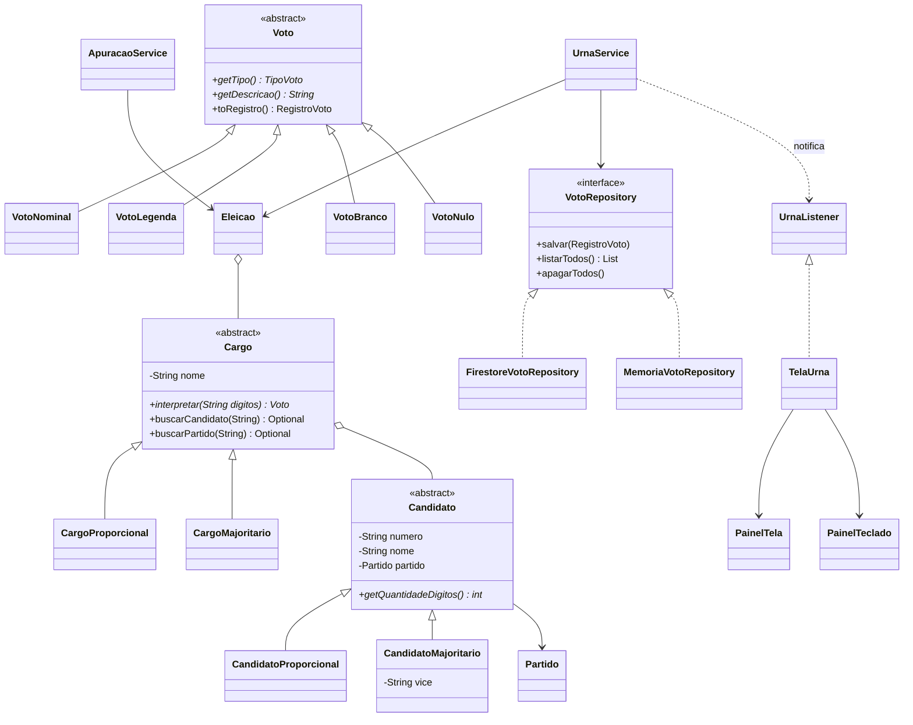

# Urna Cidadã 🗳️

**Simulador de urna eletrônica em Java**
AV3 – Programação Orientada a Objetos – Ciência da Computação – UNIJORGE – 2026

Simulador de urna eletrônica simplificada em **Java**, com interface gráfica em **Java Swing** e persistência
dos votos em nuvem no **Firebase (Cloud Firestore)**. A votação é sequencial para dois cargos:

| Ordem | Cargo     | Tipo         | Dígitos | Particularidades |
|-------|-----------|--------------|---------|------------------|
| 1º    | Vereador  | Proporcional | 5       | Voto de legenda quando o partido existe mas o candidato não |
| 2º    | Prefeito  | Majoritário  | 2       | Mostra o vice; número inexistente = nulo |

> ⚠️ Projeto acadêmico. Não é a urna oficial e não tem vínculo com a Justiça Eleitoral.
> Todos os partidos e candidatos são **fictícios**.

---

## 1. Requisitos

- **JDK 17 ou superior**
- **Maven** (já vem embutido no IntelliJ IDEA, NetBeans e Eclipse)
- Internet na primeira compilação (para baixar as bibliotecas) e para gravar no Firebase

## 2. Como executar

### Pela IDE (mais fácil)
1. Abra a pasta `urna-cidada` como **projeto Maven** (IntelliJ: *File › Open* e escolha a pasta; NetBeans: *Open Project*).
2. Aguarde o download das dependências.
3. Rode a classe `br.edu.unijorge.urnacidada.Main`.

### Pelo terminal
```bash
mvn test            # roda os testes automatizados (JUnit 5)
mvn exec:java       # abre a urna
mvn package         # gera target/urna-cidada.jar (executável, com todas as dependências)
java -jar target/urna-cidada.jar
```

Sem o arquivo de credenciais do Firebase, a urna abre em **modo offline** (votos só na memória) — útil
para testar a interface. A barra inferior mostra em qual modo ela está.

## 3. Configurando o Firebase (Cloud Firestore)

1. Acesse <https://console.firebase.google.com> e clique em **Adicionar projeto**.
2. No menu lateral, abra **Firestore Database › Criar banco de dados** (pode escolher o local `southamerica-east1`, São Paulo).
3. Vá em **⚙️ Configurações do projeto › Contas de serviço › Gerar nova chave privada**.
4. Renomeie o arquivo baixado para **`serviceAccountKey.json`** e coloque-o na **pasta raiz do projeto**
   (a mesma do `pom.xml`).
5. Rode o programa: a barra inferior deve mostrar **“Conectado ao Firebase (Cloud Firestore)”**.

Alternativa: indique o caminho do arquivo pela variável de ambiente `URNA_FIREBASE_CREDENCIAIS`.
Se rodar a urna em mais de um computador, defina `URNA_ID` (ex.: `urna-lab-02`) em cada um.

> 🔒 **Nunca envie o `serviceAccountKey.json` para o GitHub.** Ele dá acesso total ao projeto e já está no `.gitignore`.

### Modelo de dados no Firestore

Coleção **`votos`** — um documento por voto, com ID automático:

| Campo          | Tipo      | Exemplo             |
|----------------|-----------|---------------------|
| `cargo`        | string    | `"Vereador"`        |
| `tipo`         | string    | `"NOMINAL"`, `"LEGENDA"`, `"BRANCO"`, `"NULO"` |
| `numero`       | string    | `"42010"` (vazio no branco) |
| `descricao`    | string    | `"Nina Biblioteca"` |
| `siglaPartido` | string/null | `"PLIV"`          |
| `urnaId`       | string    | `"urna-01"`         |
| `dataHora`     | timestamp | horário do servidor |

Nenhum dado do eleitor é gravado — **o voto é secreto**, como na urna real.

## 4. Como votar

1. Digite o número do candidato (botões da tela ou teclado do computador).
2. Confira nome, partido e foto. Aperte **CONFIRMA** (verde) ou **CORRIGE** (laranja) para recomeçar.
3. Para votar em branco: **BRANCO** (sem ter digitado nada) e depois **CONFIRMA**.
4. Após o último cargo aparece **FIM**. A urna é liberada para o próximo eleitor automaticamente (5 s)
   ou pelo menu *Mesário › Liberar próximo eleitor*.

| Tecla do computador | Ação |
|---|---|
| `0`–`9` (ou teclado numérico) | Números |
| `Enter` | CONFIRMA |
| `Backspace` / `Delete` | CORRIGE |
| `B` | BRANCO |
| `Ctrl+R` | Boletim de urna (apuração) |
| `Ctrl+L` | Liberar próximo eleitor |
| `Ctrl+H` | Ajuda |

### Candidatos fictícios

| Partido | Nº | Prefeito (vice) | Vereadores |
|---|---|---|---|
| PBIC – Partido das Bicicletas | 31 | Clara Pedal (Otávio Roda) | 31001 Marcos Guidão · 31123 Teca Ciclovia |
| PLIV – Partido dos Livros | 42 | Bento Leitura (Sofia Página) | 42010 Nina Biblioteca · 42222 Hugo Poesia |
| PMUS – Partido da Música | 53 | Lia Batuque (Davi Pandeiro) | 53333 Zeca Tambor · 53050 Mel Melodia |
| PCAJU – Partido do Pé de Caju | 64 | Joana Castanha (Rui Mangueira) | 64444 Cacau Pomar · 64007 Biu Semente |

Exemplos para testar: `42999` → voto de legenda (PLIV) · `99999` → número errado / voto nulo · `77` para prefeito → nulo.

Para simular uma eleição geral (deputado + presidente), basta trocar os nomes em `data/DadosEleicao.java`.

## 5. Estrutura do projeto

```
src/main/java/br/edu/unijorge/urnacidada/
├── Main.java                     ponto de entrada
├── model/                        entidades do domínio
│   ├── Partido, Candidato (abstrata), CandidatoProporcional, CandidatoMajoritario
│   ├── Cargo (abstrata), CargoProporcional, CargoMajoritario, Eleicao
│   ├── Voto (abstrata), VotoNominal, VotoLegenda, VotoBranco, VotoNulo
│   └── TipoVoto (enum), RegistroVoto (record gravado no banco)
├── data/DadosEleicao.java        partidos e candidatos fictícios
├── repository/                   persistência
│   ├── VotoRepository (interface)
│   ├── FirestoreVotoRepository   Firebase Cloud Firestore
│   └── MemoriaVotoRepository     modo offline / testes
├── config/FirebaseConfig.java    inicialização do Firebase
├── service/                      regras de negócio
│   ├── UrnaService               máquina de estados da urna
│   ├── UrnaListener              Observer (avisa a tela)
│   └── ApuracaoService, ResultadoCargo   boletim de urna
└── view/                         Java Swing
    ├── TelaUrna (JFrame), PainelTela, PainelTeclado, BotaoUrna
    ├── TelaBoletim (JDialog)
    └── Som                       bipes da urna (síntese de áudio)
src/test/java/...                 25 testes JUnit 5
```

## 6. Onde estão os conceitos de POO

| Conceito | Onde aparece |
|---|---|
| **Encapsulamento** | Atributos `private final` com getters em `Partido`, `Candidato`, `Cargo`; o estado da urna só muda pelos métodos de `UrnaService` (`digitar`, `corrigir`, `votarEmBranco`, `confirmar`). |
| **Herança** | `CandidatoProporcional`/`CandidatoMajoritario` estendem `Candidato`; `CargoProporcional`/`CargoMajoritario` estendem `Cargo`; os 4 tipos de voto estendem `Voto`; `BotaoUrna` estende `JButton`; `TelaUrna` estende `JFrame`. |
| **Polimorfismo** | `Cargo.interpretar(digitos)` — mesmo método, regras diferentes (o proporcional gera voto de legenda, o majoritário não). `Voto.getDescricao()`/`getTipo()` — a apuração e a gravação tratam qualquer voto igual. `VotoRepository` — a urna funciona com Firestore ou memória sem mudar nada. |
| **Abstração** | Classes abstratas `Candidato`, `Cargo`, `Voto`; interface `VotoRepository`; interface `UrnaListener` (padrão Observer). |

## 7. Diagrama de classes (resumo)



## 8. Menu do mesário

- **Boletim de urna (apuração)** — lê os votos do banco e mostra, por cargo, votos por candidato,
  % de válidos, votos por partido (nominais + legenda), brancos e nulos. Dá para copiar o boletim em texto.
- **Zerar votos** — apaga todos os votos (use antes de começar uma nova votação).
- **Liberar próximo eleitor** automático ou manual, e liga/desliga o som.

## 9. Ideias de melhorias

- Carregar partidos/candidatos de uma coleção `candidatos` no Firestore.
- Tela de mesário com senha.
- Gráficos de resultado (JFreeChart).
- Versão mobile reaproveitando o mesmo banco Firestore.
